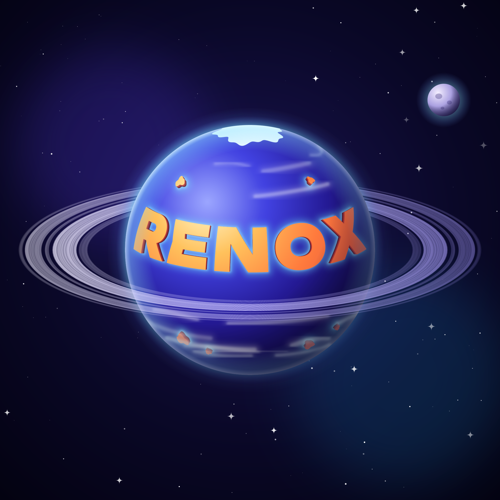

# Planet Renox logos

Logo designs for Planet Renox, written as code. Every version is self-contained in `designs/<design>/versions/<version>/`, with its own `package.json`, script and rendered files. To build one, open its folder and run:

```sh
bun install
bun run build
```

## renox-as-planet

| version | |
| --- | --- |
| [blue](designs/renox-as-planet/versions/blue) |  |

## planet-in-progress

| version | |
| --- | --- |
| [tiles](designs/planet-in-progress/versions/tiles) |  |
